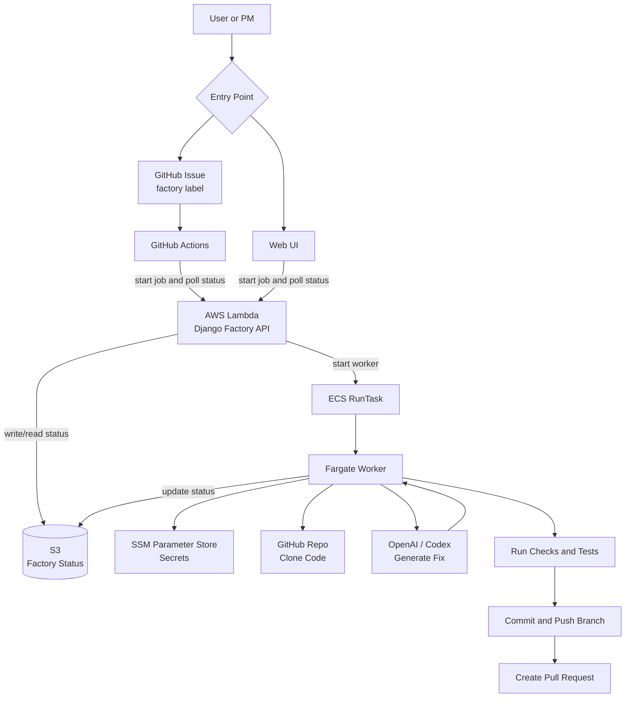

# Factory Architecture

This diagram shows the current end-to-end software factory flow.

## Flow Summary

1. A user starts from the web UI, or a PM creates a GitHub issue and adds the `factory` label.
2. The request reaches the Django factory API running on AWS Lambda.
3. Lambda writes initial status to S3 and starts an ECS Fargate worker task.
4. The worker reads secrets from SSM Parameter Store, clones the GitHub repo, and asks Codex to make the change.
5. The worker runs checks and tests.
6. If validation passes, the worker commits the change, pushes a branch, and creates a pull request.
7. S3 stores the latest job status so the UI and GitHub Actions workflow can track progress.
